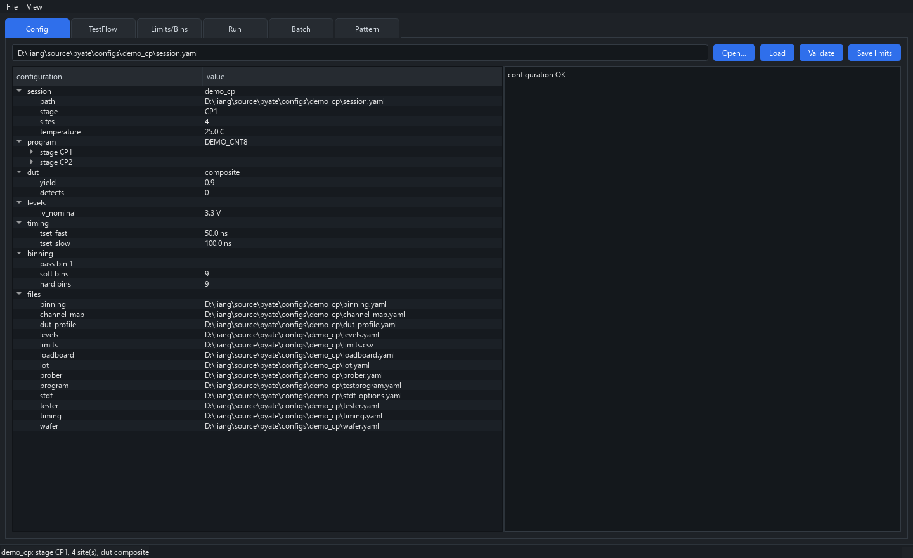
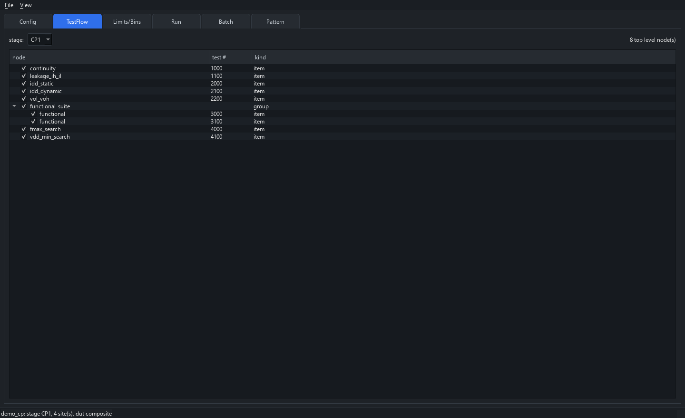
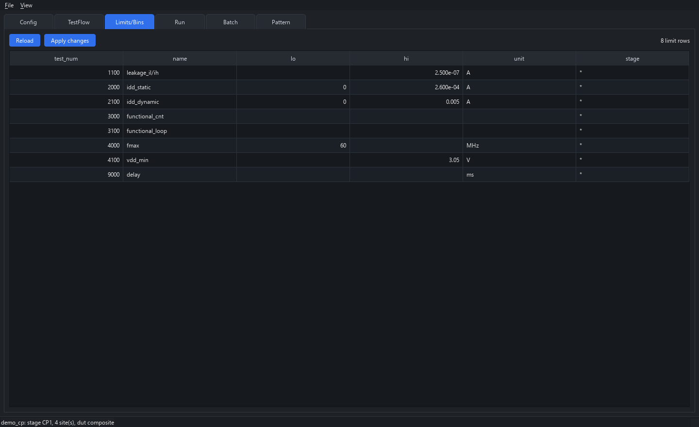
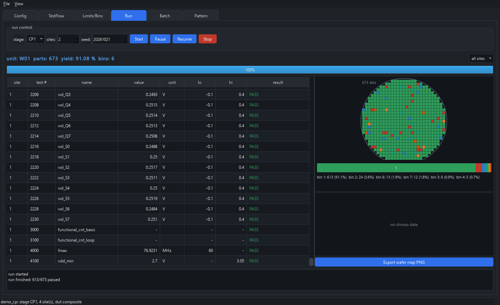
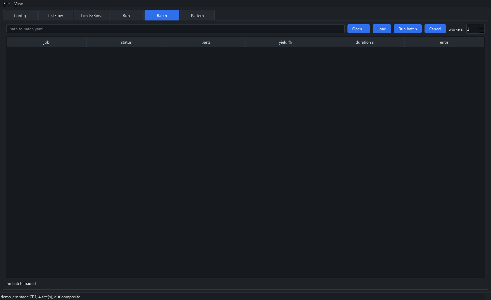
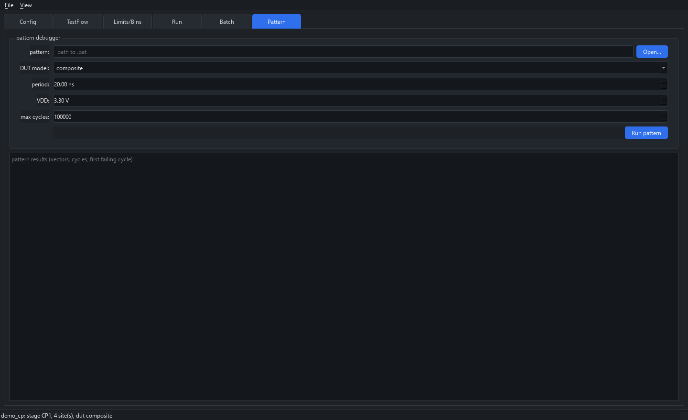

# PyATE — 离线 ATE 模拟器

纯 Python 实现的离线 ATE（Automatic Test Equipment）仿真环境：配置文件驱动、虚拟仪器 +
行为级 DUT、TestFlow/TestItem 执行引擎、多 Site 并行、CP/FT 场景、批量执行、STDF V4 输出，
并提供 CLI 与 PySide6 GUI。

不需要任何真实硬件：DPS/PMU/Relay/Digital 通道全部是虚拟仪器，DUT 是数字行为模型，
Prober/Handler 是带接触不良、卡料等真实故障的模拟器。同一个 `seed` 下整条链路逐记录可复现，
因此适合做测试程序调试、datalog 格式验证、良率/UPH 评估与流水线集成联调。

© lantianjialiang. Released under the MIT License.

## 特性

| 能力 | 说明 |
|---|---|
| 配置 | 一份 `session.yaml` 引用 `tester/channel_map/loadboard/levels/timing/limits/binning/dut_profile/...`。pin 到通道只写在 `channel_map`；`loadboard` 只保留 `board_id`、`site_count`、`relay_map`。pydantic v2 严格校验，错误带文件与字段路径 |
| 虚拟 HAL | DPS（电压/电流/钳位/过流）、PMU（continuity/leakage）、Relay、Digital（pattern 驱动/比较），资源冲突检测，虚拟时间推进 |
| DUT 模型 | `counter/shiftreg/lfsr/adder/gates/sram/composite`，pin 级数字仿真 + 可观测量（IDD、leakage、Vdiode、Vout、fmax） |
| 缺陷注入 | `stuck_at/open/short/leakage/high_idd/slow/random_bitflip`，按概率与工艺波动注入，可复现 |
| 良率采样 | 空间相关良率（边缘加权、簇状失效），逐 die 独立采样 |
| TestItem | 13 种内置项：`continuity` `leakage_ih_il` `idd_static` `idd_dynamic` `vol_voh` `functional` `vdd_min_search` `fmax_search` `shmoo` `sram_march` `power_up_down` `delay_ms` `user_code`，插件可加 |
| TestFlow | 顺序/`group`/`if-then-else` 分支/`loop`/`goto_bin`/`on_fail`（continue/stop/retest）/启用位/`only`/`skip` |
| 多 Site | `sequential/thread/process(退化为线程)/async`，item 级 `SiteBarrier` 同步、site 崩溃隔离、UPH 估算 |
| CP | 300/150 mm 圆形 wafer map、die 网格、notch、skip list、edge exclusion、touchdown 扫描、binmap（txt/svg/csv） |
| FT | Handler 循环、tray/part 编号、jam 与 contact fail、重测（bins/max_retries） |
| Lot 流转 | `CP1 → CP2 → FT1` 跨阶段，KGD（Known Good Die）逐级收窄，累计良率报告 |
| 批量 | `batch.yaml` 参数扫（笛卡尔积）、串行/线程/进程、`fail_fast`、聚合 yield/pareto/Cpk |
| STDF | 自研 V4 writer（FAR/ATR/MIR/SDR/WIR/WCR/PIR/PTR/FTR/PRR/TSR/HBR/SBR/PCR/MRR），可 gzip、大小端；`reader_check` + pystdf 交叉校验 |
| Datalog | CSV、Text、JSONL（插件）、`stats.json`（Cpk/直方图）、`summary.json` |
| GUI | 7 个页签（Config / TestFlow / Limits/Bins / Run / Pattern / STDF / Batch）、实时 datalog、wafer map、bin bar、shmoo、深浅主题、wafer map 导出 PNG |
| 插件 | pluggy hookspec + 目录扫描/entry points，`pyate plugin new` 脚手架，示例 ADC DUT 与 JSONL sink |

## 安装

要求 Python 3.10+。GUI 需要 PySide6（`pip install -e ".[gui]"`；`dev` 额外包含测试依赖）。

PowerShell（在仓库根目录）：

```powershell
python -m venv .venv
.\.venv\Scripts\Activate.ps1
pip install -e ".[dev]"
```

cmd：

```bat
python -m venv .venv
.venv\Scripts\activate.bat
pip install -e ".[dev]"
```

## 不安装 Python 直接用

在一台已经能跑开发环境的 Windows 上打包，得到一个自带解释器和界面库的目录。把整个目录拷到没装 Python 的电脑上即可。

```powershell
pip install -e ".[package]"
python tools\build_windows.py
```

产物是 `dist\pyate\`。里面有：

| 文件 | 作用 |
|---|---|
| `pyate.exe` | 命令行，用法和 `pyate` 相同 |
| `pyate-gui.exe` | 无黑色控制台的界面。双击打开，参数会转给 `gui` |
| `启动界面.bat` | 双击启动界面 |
| `configs\` | 和仓库里同一套示例 |
| `_internal\` | 打包进去的运行时，不要拆开 |

`pyate.exe` 和 `pyate-gui.exe` 必须和 `_internal`、`configs` 放在一起。只拷 exe 无法运行。

PowerShell 不会在当前目录里搜索命令，所以要先进入目录，并在文件名前加 `.\`：

```powershell
cd dist\pyate
.\pyate-gui.exe configs\demo_intro\session.yaml
.\pyate.exe config validate configs\demo_cp\session.yaml
.\pyate.exe run configs\demo_intro\session.yaml
```

`demo_cp`、`demo_ft`、`demo_intro`、`demo_batch` 都能加载。`demo_intro` 复用 `demo_cp` 的 4 site 负载板，而这次只开 1 个 site，校验会提示一条 `site_count` 警告，程序仍可运行。电源 pin 用 `tester.dps_channels`（示例里是 16 路，并且跨 site 不能重复）；其余 pin 用 `digital_channels`。

## 运行

在仓库根目录执行。装好之后直接用 `pyate`；还没安装时用模块入口，并让 Python 能找到 `src`。

PowerShell，打开最短示例（断点、pattern 调试、shmoo 的走读在 [docs/MANUAL.md](docs/MANUAL.md)）：

```powershell
$env:PYTHONPATH = "src"
python -m pyate.cli.main gui configs\demo_intro\session.yaml
```

已经 `pip install -e ".[gui]"` 时可以省略 `PYTHONPATH`：

```powershell
pyate gui configs\demo_intro\session.yaml
```

完整 CP 晶圆把 session 换成 `configs\demo_cp\session.yaml`。不带 session 会打开空窗口，再在 Config 页里选 `session.yaml`。默认浅色主题，`--theme dark` 切换深色。

同一入口也可以不进界面，直接跑一轮：

```powershell
$env:PYTHONPATH = "src"
python -m pyate.cli.main run configs\demo_intro\session.yaml
```

FT 示例把 session 换成 `configs\demo_ft\session.yaml`。其余子命令见下面的快速开始。

## 快速开始

```bash
# 1. 校验配置（错误会指出文件与字段）
pyate config validate configs/demo_cp/session.yaml

# 2. 跑一遍 CP（默认 4 sites / 2 wafers）
pyate run configs/demo_cp/session.yaml

# 3. 小规模 + 指定 stage + 覆盖参数
pyate run configs/demo_cp/session.yaml --set lot.wafers='["W01"]' --sites 2 --seed 42

# 4. 整条 lot：CP1 → CP2 → FT1（KGD 逐级流转）
pyate lot run configs/demo_cp/session.yaml --stages CP1,CP2 \
  --stage-session FT1=configs/demo_ft/session.yaml --out out/lot_demo

# 5. 批量扫参数
pyate batch run configs/demo_batch/batch.yaml --workers 4
pyate batch report configs/demo_batch/out/TEMP_X_PROFILE

# 6. STDF 校验 / 记录抽样
pyate stdf verify out/cli_run/LOT-CP-0001_W01_CP1.stdf
pyate stdf dump out/cli_run/LOT-CP-0001_W01_CP1.stdf --type PIR --type PRR --limit 5

# 7. Pattern 调试（不改配置，直接跑向量）
pyate pattern run configs/demo_cp/patterns/cnt_basic.pat --dut counter --cycles 2000

# 8. GUI（也可带上 session，见上一节「运行」）
pyate gui configs/demo_cp/session.yaml
```

`pyate run` 会打印每个 unit 的 tested/passed/yield/UPH 与产物路径；`--json` 输出机器可读结果，
`--no-stdf` 跳过 STDF，`--resume` 从上次 touchdown 续跑。

### 产物

每次运行写到 `--out`（默认取 `stdf.output_dir`）：

```
out/cli_run/
├── summary.json        # 整轮汇总（yield/UPH/bin/单位）
├── run_snapshot.yaml   # 生效配置快照（复现用）
├── LOT-CP-0001_W01_CP1.stdf   # STDF V4
├── W01_summary.json    # 单 wafer 汇总
├── W01_binmap.csv      # die 级 binmap（txt/svg 同目录）
└── stats.json          # 每项测试的统计与 Cpk
```

## 目录结构

```
src/pyate/
├── api/         # 对外门面：Session/RunOptions/RunHandle/LotRunner（GUI 与 CLI 都只用这层）
├── config/      # pydantic 模型 + YAML 加载器 + 校验器
├── hal/         # 虚拟仪器（dps/pmu/relay/digital/timing）与资源管理
├── dut/         # DUT 行为模型、缺陷注入、良率采样
├── pattern/     # .pat 解析、向量模型、生成器、执行引擎
├── testitems/   # 内置 TestItem 库与注册表
├── engine/      # Flow 执行、binning、多 site 调度、事件总线、控制器
├── scenario/    # CP/FT 场景：wafer map、prober、handler
├── batch/       # 批量 spec/queue/runner/report/retest
├── datalog/     # CSV/Text/JSONL sink、stats、STDF writer/reader_check
├── plugins/     # pluggy hookspec、加载器、脚手架
├── gui/         # PySide6 面板 + 无 Qt 依赖的 view model
└── cli/         # argparse 命令行

tools/           # gen_demo_configs（生成示例配置）、coverage_std（trace 覆盖率）、
                 # export_wafer_map（binmap → PNG）
examples/        # 参考插件（ADC DUT / JSONL sink）与参考运行产物
```

分层是单向的：`gui → api → engine → testitems → hal/dut/pattern → config/datalog`。
`core` 不 import `gui`（`tests/unit/test_layering.py` 会检查）。

## 测试

```bash
pytest                        # 全部（约 2 分钟，含离屏 GUI）
pytest tests/unit -q          # 单元
pytest tests/component -q     # HAL / testitem / flow
pytest tests/integration -q   # E2E-CP/FT/FLOW/BATCH/EXT/REPRO
pytest tests/concurrency -q   # 多 site / barrier
pytest tests/gui -q           # E2E-GUI（QT_QPA_PLATFORM=offscreen）
```

覆盖规格 14 的七个端到端场景：

| 场景 | 用例 |
|---|---|
| E2E-CP | `tests/integration/test_e2e_cp.py` |
| E2E-FT | `tests/integration/test_e2e_ft.py` |
| E2E-FLOW | `tests/integration/test_e2e_flow.py` |
| E2E-BATCH | `tests/integration/test_e2e_batch.py` |
| E2E-EXT | `tests/integration/test_e2e_ext.py` |
| E2E-REPRO | `tests/integration/test_reproducibility.py` |
| E2E-GUI | `tests/gui/test_gui_smoke.py` |

## 质量门槛

| 门槛 | 命令 | 现状 |
|---|---|---|
| 全部测试 | `pytest` | 302 例通过 |
| 行覆盖率 ≥85%（`src/pyate`） | `python tools/coverage_std.py --fail-under 85` | 见下 |
| 分层约束 | `pytest tests/unit/test_layering.py` | core 不含 Qt/gui，gui 只用 `pyate.api` |
| 示例配置可校验 | `pyate config validate configs/demo_cp/session.yaml`（demo_ft 同） | OK |
| lint / 类型 | `ruff check src tests tools` / `mypy` | 配置已就绪；**当前环境离线装不上这两个包**，见 D19 |

`tools/coverage_std.py` 用 `sys.settrace` 自建行计数器统计覆盖率（离线环境装不了
`pytest-cov`），支持 `--save-counts/--counts` 缓存计数，重复分析不必重跑整套测试；
`--json` 输出可直接喂给 CI。

## 参考产物

`examples/out/` 下有三份可直接查看的运行结果（配置与种子都写在各自的 `run_snapshot.yaml`）：

- `cp/` — CP1，673 die，yield 92.42%，含 `LOT-CP-0001_W01_CP1.stdf`、binmap（csv/svg/txt）与 `W01_map.png`
- `ft/` — FT1，40 part，yield 90.0%（含 contact fail 与重测）
- `lot/` — CP1 → CP2 → FT1 的 KGD 流转，`lot_report.md` 里是分阶段良率表

## 界面

`pyate gui configs/demo_cp/session.yaml` 打开主窗口。页签顺序是 Config、TestFlow、Limits/Bins、Run、Pattern、STDF、Batch。
下面的截图由 `tools/shoot_gui.py` 离屏渲染真实窗口得到（不是手绘原型）：

| | |
|---|---|
|  |  |
| Config：session 全部配置项，键值分列 | TestFlow：stage 的 flow 树，勾选框控制启用位 |
|  |  |
| Limits/Bins：limits 可直接改并回写 CSV | Run：实时 datalog + wafer map + bin bar |
|  |  |
| Batch：job 状态与良率汇总 | Pattern：直接跑 `.pat`，报第一个失败周期 |

浅色主题见 `docs/images/light/`；重新生成截图：

```bash
python tools/shoot_gui.py --run --sites 2          # 深色 + 跑一片 wafer 填充图
python tools/shoot_gui.py --theme light --out docs/images/light
```

## 文档

| 文档 | 内容 |
|---|---|
| [docs/MANUAL.md](docs/MANUAL.md) | 使用说明书：工作原理、GUI 操作、demo_intro 走读 |
| [docs/QUICKSTART.md](docs/QUICKSTART.md) | 30 分钟上手：从校验配置到读懂产物 |
| [docs/CONFIG_REFERENCE.md](docs/CONFIG_REFERENCE.md) | 全部 YAML 字段、默认值、枚举与踩坑点 |
| [docs/EXTENDING.md](docs/EXTENDING.md) | 写 TestItem / DUT 模型 / Datalog sink 插件 |
| [docs/STDF_MAPPING.md](docs/STDF_MAPPING.md) | 配置与测试项如何落到 STDF 记录字段 |
| [docs/DECISIONS.md](docs/DECISIONS.md) | 规格歧义处的取舍与理由 |
| [docs/PROGRESS.md](docs/PROGRESS.md) | 逐阶段实现与验收记录 |

## 已知边界

- `parallel_mode: process` 退化为线程池（DUT 模型不可 pickle），日志会给出告警。
- 温度只影响 limit 查找与 STDF 记录，DUT 模型本身不随温度参数化（见 D15）。
- `run.only/run.skip` 不会自动补齐前序测试建立的物理条件（见 D16）。
- resume 以 touchdown 为粒度，不做 die 级续跑（见 D17）。
