# PyATE — 离线 ATE 模拟器

纯 Python 实现的离线 ATE（Automatic Test Equipment）仿真环境：配置文件驱动、虚拟仪器 +
行为级 DUT、TestFlow/TestItem 执行引擎、多 Site 并行、CP/FT 场景、批量执行、STDF V4 输出，
并提供 CLI 与 PySide6 GUI。

不需要任何真实硬件：DPS/PMU/Relay/Digital 通道全部是虚拟仪器，DUT 是数字行为模型，
Prober/Handler 是带接触不良、卡料等真实故障的模拟器。同一个 `seed` 下整条链路逐记录可复现，
因此适合做测试程序调试、datalog 格式验证、良率/UPH/OEE 评估与流水线集成联调。

© lantianjialiang. Released under the MIT License.

## 特性

| 能力 | 说明 |
|---|---|
| 配置 | 一份 `session.yaml` 引用 `tester/channel_map/loadboard/levels/timing/limits/binning/dut_profile/...`。pin 到通道只写在 `channel_map`；`loadboard` 只保留 `board_id`、`site_count`、`relay_map`。pydantic v2 严格校验，错误带文件与字段路径 |
| 虚拟 HAL | DPS（电压/电流/钳位/过流）、PMU（continuity/leakage）、Relay、Digital（pattern 驱动/比较），资源冲突检测，虚拟时间推进 |
| DUT 模型 | `counter/shiftreg/lfsr/adder/gates/sram/composite`，pin 级数字仿真 + 可观测量（IDD、leakage、Vdiode、Vout、fmax） |
| 缺陷注入 | `stuck_at/open/short/leakage/high_idd/slow/random_bitflip`，按概率与工艺波动注入，可复现 |
| 良率采样 | 空间相关良率（边缘加权、簇状失效），逐 die 独立采样 |
| TestItem | 13 种内置项：`continuity` `leakage_ih_il` `idd_static` `idd_dynamic` `vol_voh` `functional` `vdd_min_search` `fmax_search` `shmoo` `sram_march` `power_up_down` `delay_ms` `user_code`，插件可加 |
| TestFlow | 顺序/`group`/`if-then-else` 分支/`loop`/`goto_bin`/`on_fail`（continue/stop/retest）/启用位/`only`/`skip` |
| 多 Site | `sequential/thread/process(退化为线程)/async`，item 级 `SiteBarrier` 同步、site 崩溃隔离。UPH 与 OEE 按模型时间估算（测试、index、卡料恢复） |
| CP | 300/150 mm 圆形 wafer map、die 网格、notch、skip list、edge exclusion、touchdown 扫描、binmap（txt/svg/csv） |
| FT | 输入 tray 按槽取放（未测 / 测试中 / 已取走）、site 插座、输出 hard bin。`demo_ft` 是 20×25 槽、每次 8 site、2 盘 × 500 颗。含 jam、contact fail、重测 |
| Lot 流转 | `CP1 → CP2 → FT1` 跨阶段，KGD（Known Good Die）逐级收窄，累计良率报告 |
| 批量 | `batch.yaml` 参数扫（笛卡尔积）、串行/线程/进程、`fail_fast`、聚合 yield/pareto/Cpk |
| STDF | 自研 V4 writer（FAR/ATR/MIR/SDR/WIR/WCR/PIR/PTR/FTR/PRR/TSR/HBR/SBR/PCR/MRR），可 gzip、大小端；`reader_check` + pystdf 交叉校验 |
| Datalog | CSV、Text、JSONL（插件）、`stats.json`（Cpk/直方图）、`summary.json` |
| GUI | 7 个页签（Config / TestFlow / Limits/Bins / Run / Pattern / STDF / Plugins，见[界面与使用](#界面与使用)）。Run 页有 datalog、Summary（可按 site / wafer / part 组合，含 mean / stdev / Cp / Cpk）、限值线、wafer、Tray、净 UPH / gross / OEE，Shmoo 子页可一键扫 VDD × period（标称 die，网格与 flow 一致）；按 test number 下断点（one shot）、Pause / Step / Resume；TestFlow 里可单独跑选中的一项，结果直接进 Run 页 |
| 插件 | pluggy hookspec + 目录扫描/entry points，`pyate plugin new` 脚手架、`pyate plugin list` 查看加载结果，GUI **Plugins** 页可加载/启停插件，示例见 `examples/plugins/`（ADC DUT / JSONL sink / failwatch 钩子） |

## 安装

要求 Python 3.10+。GUI 需要 PySide6（`pip install -e ".[gui]"`；`dev` 额外包含测试依赖）。

PowerShell（在仓库根目录）：

```powershell
python -m venv .venv
.\.venv\Scripts\Activate.ps1
pip install -e ".[dev]"
```

cmd：

```bat
python -m venv .venv
.venv\Scripts\activate.bat
pip install -e ".[dev]"
```

## 不安装 Python 直接用

在一台已经能跑开发环境的 Windows 上打包，得到一个自带解释器和界面库的目录。把整个目录拷到没装 Python 的电脑上即可。

```powershell
pip install -e ".[package]"
python tools\build_windows.py
```

产物是 `dist\pyate\`。里面有：

| 文件 | 作用 |
|---|---|
| `pyate.exe` | 命令行，用法和 `pyate` 相同 |
| `pyate-gui.exe` | 无黑色控制台的界面。双击打开，参数会转给 `gui` |
| `启动界面.bat` | 双击启动界面 |
| `configs\` | 和仓库里同一套示例 |
| `_internal\` | 打包进去的运行时，不要拆开 |

`pyate.exe` 和 `pyate-gui.exe` 必须和 `_internal`、`configs` 放在一起。只拷 exe 无法运行。

PowerShell 不会在当前目录里搜索命令，所以要先进入目录，并在文件名前加 `.\`：

```powershell
cd dist\pyate
.\pyate-gui.exe configs\demo_intro\session.yaml
.\pyate-gui.exe configs\demo_ft\session.yaml
.\pyate.exe config validate configs\demo_cp\session.yaml
.\pyate.exe run configs\demo_intro\session.yaml
```

`demo_cp`、`demo_ft`、`demo_intro`、`demo_shmoo`、`demo_batch` 都能加载。`demo_intro` 复用 `demo_cp` 的 4 site 负载板，而这次只开 1 个 site，校验会提示一条 `site_count` 警告，程序仍可运行。`demo_shmoo` 是给 shmoo 用的：1 site、小晶圆、慢速 DUT，跑完 Run → Shmoo 就有一张带速度边界的图。电源 pin 用 `tester.dps_channels`（示例里是 16 路，并且跨 site 不能重复）；其余 pin 用 `digital_channels`。

## 运行

在仓库根目录执行。装好之后直接用 `pyate`；还没安装时用模块入口，并让 Python 能找到 `src`。

PowerShell，打开最短示例（断点、pattern 调试、shmoo 的走读在 [docs/MANUAL.md](docs/MANUAL.md)）：

```powershell
$env:PYTHONPATH = "src"
python -m pyate.cli.main gui configs\demo_intro\session.yaml
```

已经 `pip install -e ".[gui]"` 时可以省略 `PYTHONPATH`：

```powershell
pyate gui configs\demo_intro\session.yaml
```

完整 CP 晶圆把 session 换成 `configs\demo_cp\session.yaml`。不带 session 会打开空窗口，再在 Config 页里选 `session.yaml`。默认浅色主题，`--theme dark` 切换深色。

同一入口也可以不进界面，直接跑一轮：

```powershell
$env:PYTHONPATH = "src"
python -m pyate.cli.main run configs\demo_intro\session.yaml
```

FT、输入 tray 和 OEE 用 `configs\demo_ft\session.yaml`（打包后同样先 `cd dist\pyate`，再 `.\pyate-gui.exe configs\demo_ft\session.yaml`）。打开后到 **Run** 页点 **Start**。第一抓之后会切到 **Tray**：

- 输入盘按 `handler.tray_cols` × `tray_rows` 画槽。`demo_ft` 是 20×25，和 `parts_per_tray: 500` 对齐。取料从左到右、从上到下，每次取 `layout` 个 site（4×2，共 8）。最后一抓只有 4 颗，空出来的 site 被 mask。
- 槽的颜色是未测、测试中、已取走。下面一行是各 site 状态，再下面是输出 hard bin 的累计颗数。重测回到原来的槽，并从上一个 hard bin 里移走，避免计两次。
- 顶上 `uph` 是净产能，`gross` 只计测试和 index。`oee` 显示百分数，后面的 `A/P/Q` 是可用率、性能、质量。时间来自模型：每个 touchdown 加上测试时间和 index（`cycle_time_ms` + `index_time_ms`，示例里 index 是 180 ms）；发生卡料再加 `jam_recovery_ms`（示例 30000 ms）。一次卡料会把可用率拉低。500 颗对 8 site 的尾批不满，性能会略低于满载。

`summary.json` 和每个 unit 的 `*_summary.json` 里的 `uph` 是同一套净 UPH。gross、理论 UPH 和 A/P/Q 在界面上随着 PROGRESS 更新。其余子命令见下面的快速开始。

## 快速开始

```bash
# 1. 校验配置（错误会指出文件与字段）
pyate config validate configs/demo_cp/session.yaml

# 2. 跑一遍 CP（默认 4 sites / 2 wafers）
pyate run configs/demo_cp/session.yaml

# 3. 小规模 + 指定 stage + 覆盖参数
pyate run configs/demo_cp/session.yaml --set lot.wafers='["W01"]' --sites 2 --seed 42

# 4. 整条 lot：CP1 → CP2 → FT1（KGD 逐级流转）
pyate lot run configs/demo_cp/session.yaml --stages CP1,CP2 \
  --stage-session FT1=configs/demo_ft/session.yaml --out out/lot_demo

# 5. 批量扫参数
pyate batch run configs/demo_batch/batch.yaml --workers 4
pyate batch report configs/demo_batch/out/TEMP_X_PROFILE

# 6. STDF 校验 / 记录抽样
pyate stdf verify out/cli_run/LOT-CP-0001_W01_CP1.stdf
pyate stdf dump out/cli_run/LOT-CP-0001_W01_CP1.stdf --type PIR --type PRR --limit 5

# 7. Pattern 调试（不改配置，直接跑向量）
pyate pattern run configs/demo_cp/patterns/cnt_basic.pat --dut counter --cycles 2000

# 8. GUI（也可带上 session，见上一节「运行」）
pyate gui configs/demo_cp/session.yaml

# 9. shmoo 演示：1 site、21×31 的 VDD × period，看速度边界
pyate run configs/demo_shmoo/session.yaml
pyate gui configs/demo_shmoo/session.yaml   # Run 页 → Shmoo 子页
```

`pyate run` 会打印每个 unit 的 tested/passed/yield/净 UPH 与产物路径；`--json` 输出机器可读结果，
`--no-stdf` 跳过 STDF，`--resume` 从上次 touchdown 续跑。这里的 UPH 用模型时间，和界面上的净 `uph` 相同。

### 产物

每次运行写到 `--out`（默认取 `stdf.output_dir`）：

```
out/cli_run/
├── summary.json        # 整轮汇总（yield/净 UPH/bin/单位）
├── run_snapshot.yaml   # 生效配置快照（复现用）
├── LOT-CP-0001_W01_CP1.stdf   # STDF V4
├── W01_summary.json    # 单 wafer 汇总
├── W01_binmap.csv      # die 级 binmap（txt/svg 同目录）
└── stats.json          # 每项测试的统计与 Cpk
```

## 界面与使用

下面每张图都是 `tools/shoot_gui.py` 离屏渲染的真实窗口（除 Shmoo 用 `configs\demo_shmoo` 外，都是
`configs\demo_cp`、2 个 site、跑完 W01 的那一次），不是手绘原型，界面上的数字就来自那次运行。默认浅色主题，
View 菜单切深色。

### 打开窗口

| 场景 | 命令 |
|---|---|
| 已 `pip install -e ".[gui]"` | `pyate gui configs\demo_cp\session.yaml` |
| 未安装（仓库内） | `$env:PYTHONPATH = "src"`，再 `python -m pyate.cli.main gui configs\demo_cp\session.yaml` |
| 打包版 | `cd dist\pyate` 后 `.\pyate-gui.exe configs\demo_cp\session.yaml`，或双击 `启动界面.bat` |

带 session 就直接打开；不带是空窗口，再 **File → Open session** 选文件。`--theme dark` 以深色启动。

| 快捷键 | 作用 |
|---|---|
| `Ctrl+O` | 打开 session |
| `Ctrl+Shift+P` | 跳到 Plugins 页 |
| `Ctrl+Q` | 退出 |
| View 菜单 | Light / Dark 二选一，当前主题前打勾 |

状态栏左边是 `demo_cp: stage CP1, 4 site(s)`，右边是版权。7 个页签按数据流排：先看配置（Config /
TestFlow / Limits-Bins），再跑（Run），再看产物（Pattern / STDF / Plugins）。批量扫参没有界面，用 `pyate batch`。

### 1. Config：这份 session 由什么组成

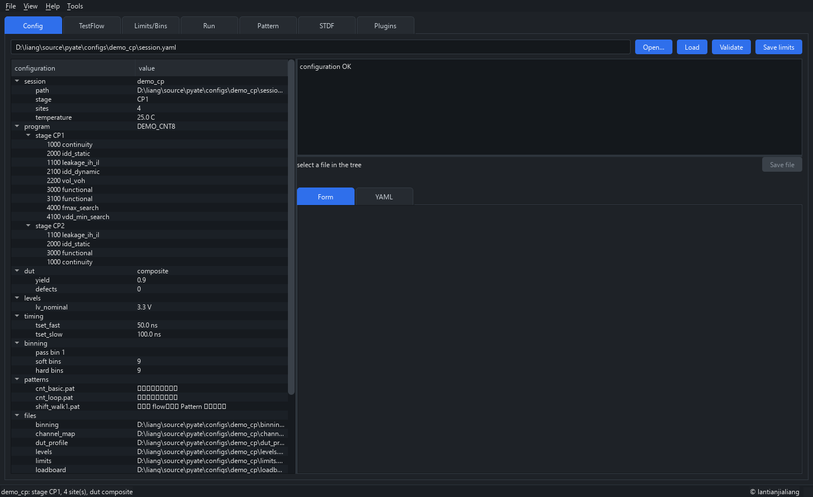

- 左树从上到下是 session 里的对象：`session`（stage、site 数、温度）、`program`（每个 stage 的 flow 与 test
  number）、`dut`、`yield`、`defects`、`levels`、`timing`、`binning`、`patterns`、`files`。选中一项，右边出
  **Form** 和 **YAML** 两个视图。
- 顶部是当前文件，右侧四个按钮：**Open...** 换 session、**Load** 重新读盘、**Validate** 只校验不改文件、
  **Save limits** 把 Limits 页的改动写进 CSV。
- 校验结果在右上角（这里是 `configuration OK`）；失败时带文件与字段路径，磁盘上的文件不会被改。
- `patterns` 下的 `.pat` 只读；`files` 里每一项都能改，**Save file** 才落盘。

### 2. TestFlow 与 Limits/Bins

| | |
|---|---|
| 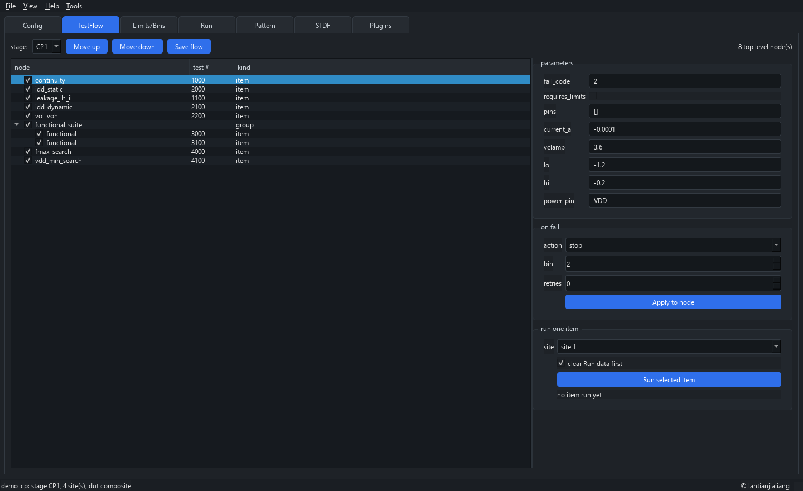 | 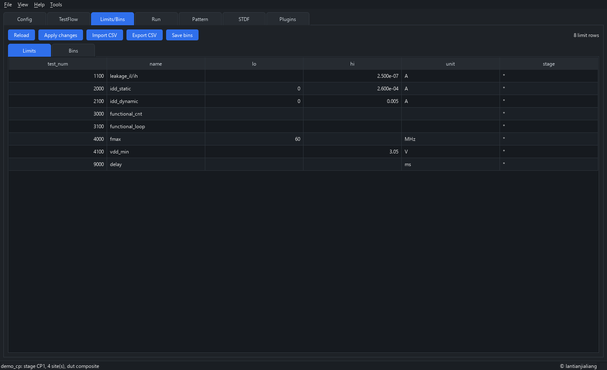 |
| TestFlow：stage 的 flow 树，勾选框是 `enabled` 位 | Limits/Bins：限值可直接改，回写 CSV |

- 勾选框就是 `enabled`，取消会写回 `testprogram.yaml`，执行时跳过该项。选中节点，右边是参数、`on_fail`
  （continue / stop / retest）和 **Apply to node**；**Move up / Move down** 或拖拽可排序，移动后仍保持选中。
- 右侧 **run one item** 只跑这一项：选 site（或 all sites）点 **Run selected item**，结果进 Run 页。参数取表单
  当前值，不用先 Apply；默认勾着 **clear Run data first**，免得单项样本混进整轮把 Cpk 算错。
- Limits 改完 lo/hi 先 **Apply changes**，再到 Config 页 **Save limits** 才写回 `limits.csv`。

### 3. Run：开始，以及断点怎么用

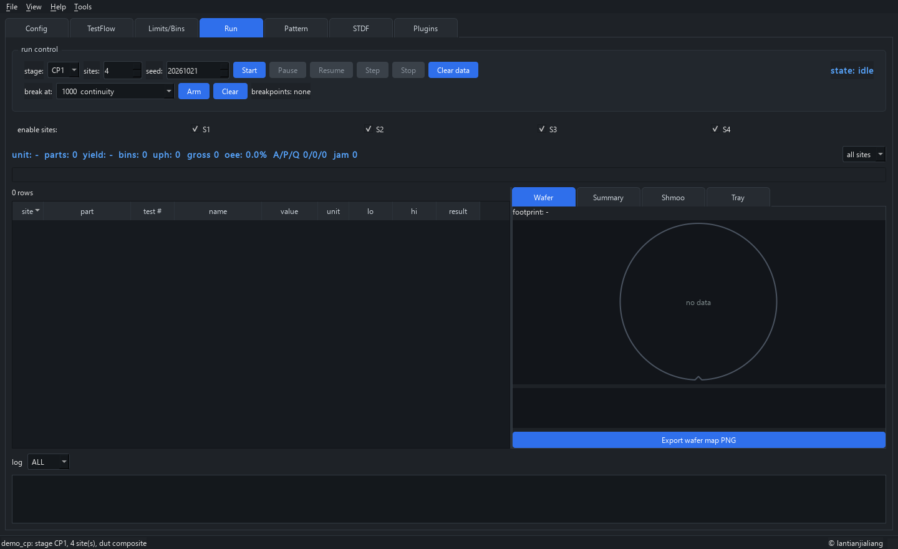

run control 分两行：

- 第一行 `stage / sites / seed`，加 **Start**、**Pause**、**Resume**、**Step**、**Stop**、**Clear data**；
  右边 `state:` 显示 `idle / running / paused / done / stopped`。
- 第二行 `break at:`：下拉里是当前 stage 的每一项（显示成 `3100  functional`），选中点 **Arm**，标签变成
  `breakpoints: 3100 (one shot)`；也可以直接输入编号再 Arm。
- `enable sites` 的勾选就是这次要测的 site，取消的写进 `run.disabled_sites`。
- 指标行：`unit`、`parts`、`yield`、`bins`、`uph`（净）、`gross`、`oee`，后面 `A/P/Q` 是可用率 / 性能 /
  质量，`jam` 是卡料次数。
- 左边 datalog（site / part / test # / name / value / unit / lo / hi / result），右边四个子页
  Wafer / Summary / Shmoo / Tray，最下面是日志（级别 ALL / INFO / ERROR）。

断点是**每项开始之前停一次**，按 test number 记、所有 site 共用，命中即消费（one shot），所以 Resume 会真的
往下跑，不会在下一颗 die 的同一项再停：

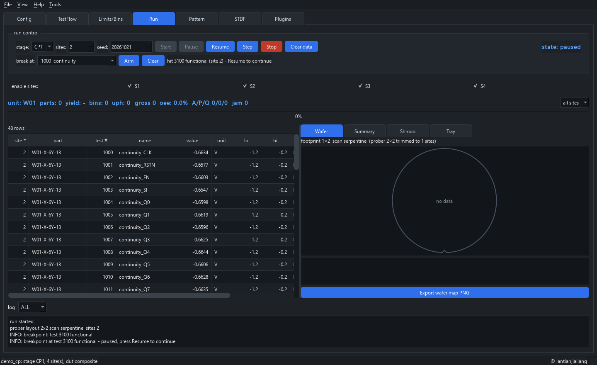

1. Arm 好断点再 **Start**。上一轮数据先清掉，flow 跑过前面的项后在这一项之前停下：`state: paused`，日志一行
   `breakpoint at test 3100 functional - paused, press Resume to continue`，标签变成
   `hit 3100 functional (site 2) - Resume to continue`。
2. 此刻按钮自动切换：**Pause** 变灰，**Resume / Step / Stop** 可点，**Start** 禁用。**Step** 只执行接下来
   的一项，然后再次暂停。
3. **Resume** 跑到底，**Stop** 放弃这一轮，**Clear data** 丢掉结果并停掉正在跑的那轮（断点和 site 勾选不动），
   **Clear** 清空所有断点。
4. 想逐项看又懒得设断点：Start 后马上 Pause，然后反复 Step。

### 4. 结果：Wafer / Summary / Shmoo / Tray

跑完一轮（图里 W01、2 site：673 颗、良率 88.26%、净 UPH 25172、OEE 84.2%）：

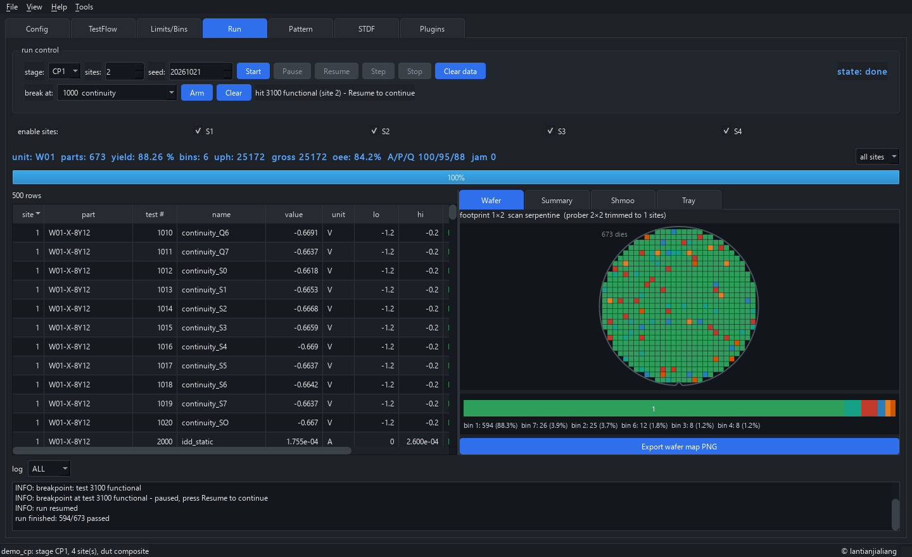

- **Wafer**：每颗 die 按 soft bin 上色，边缘 die 是完整方块；悬停看坐标、bin 和第一个失败项；下面一条是
  bin 比例，**Export wafer map PNG** 存图。
- **Summary**：`group by` 可选 test / site / wafer / part，每个测试一行 `n / pass / fail / mean / stdev /
  min / max / lo / hi / cp / cpk`；选中一行，下面同时画 histogram、trend、probability，橙色虚线是 lower
  limit、红色虚线是 high limit。

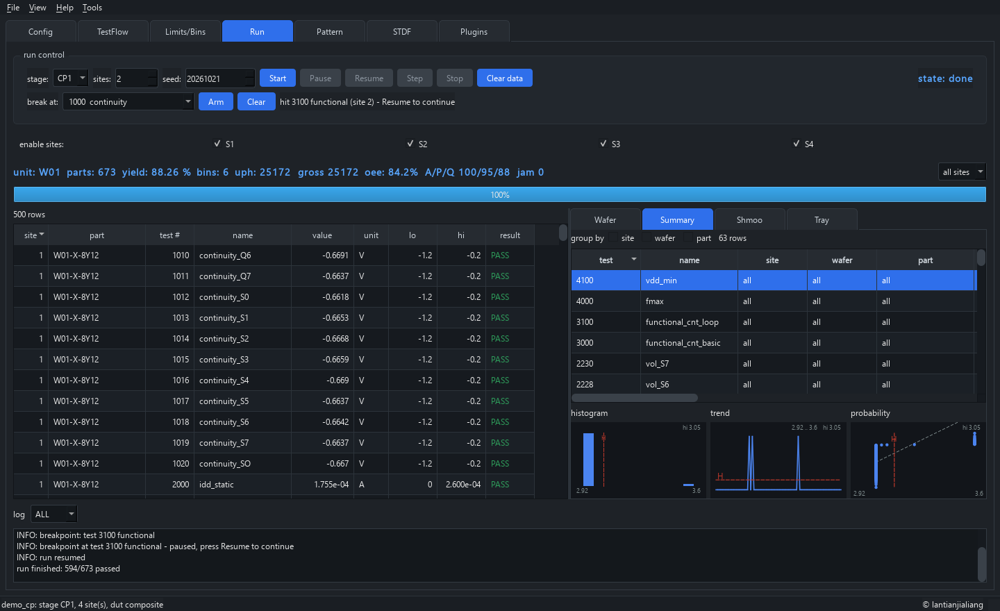

- **Shmoo**：flow 里的 `shmoo` 项跑完后出图，横轴 period、纵轴 VDD，可导出 PNG / CSV。想看真正有边界的图用
  `configs\demo_shmoo\session.yaml`；不想把 shmoo 放进每颗 die 时，用本页 **Run shmoo** 只扫一次标称 die。

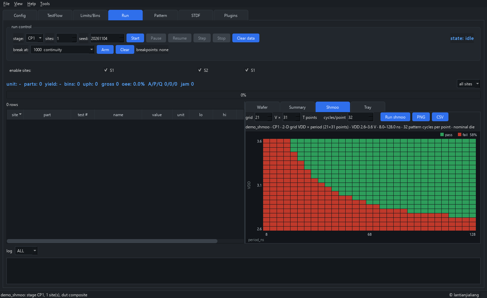

- **Tray**：只有 FT（`configs\demo_ft`）才有内容。输入盘按 `tray_cols × tray_rows` 画槽，颜色是未测 /
  测试中 / 已取走，下一行是各 site 状态，再下面是 hard bin 累计；重测回原槽，并从上一个 bin 里移走。

### 5. Pattern：不改配置调向量

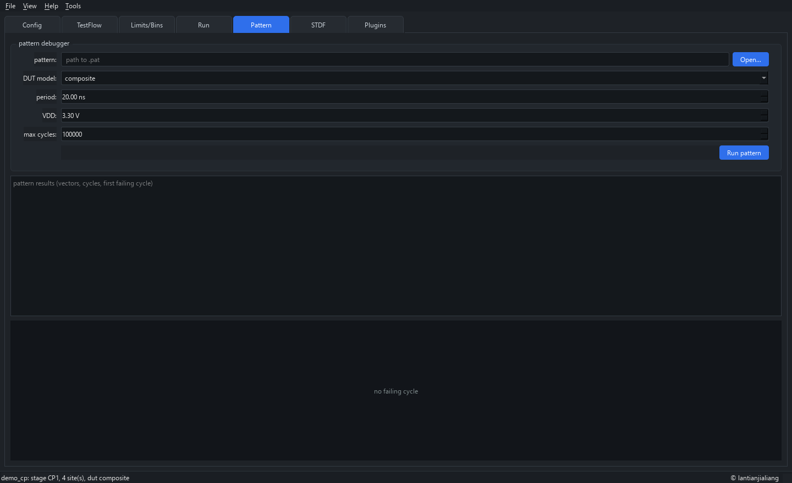

**Open...** 选 `.pat`，选 DUT、VDD、period，点 **Run pattern**。失败时给出第一个失败周期、期望值和实际值，
下面的比较条按 pin 画 expected / actual，不一致的 pin 标红。`configs\demo_intro\patterns\cnt_fail.pat` 是
故意写错的例子（第二拍 `SO` 该 `L` 却写成 `H`），换成 `cnt_basic.pat` 就是 PASS。

### 6. STDF：把产物读回来

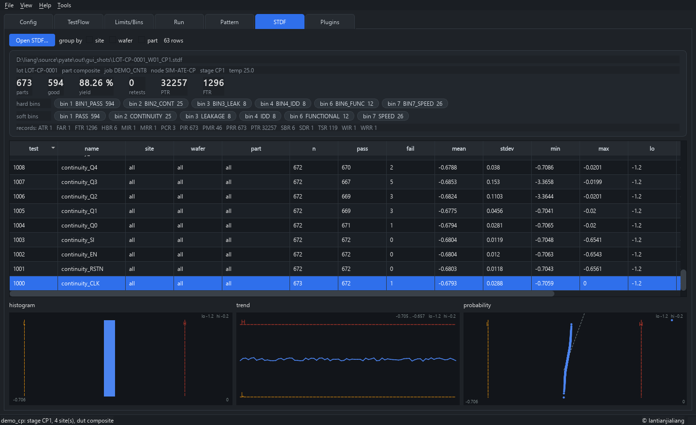

**Open STDF...** 选一次运行写出的 `.stdf`。顶部是统计卡片：文件路径、`lot / part / job / node / stage / temp`
一行、`parts / good / yield / retests / PTR / FTR` 六个数字、hard / soft bin 芯片、各记录条数
（FAR/ATR/MIR/SDR/WIR/WCR/PIR/PTR/FTR/PRR/TSR/HBR/SBR/PCR/MRR）。下面的表和 Run 的 Summary 一样，也能按
test / site / wafer / part 分组——数据来自文件里的 PTR/FTR，不是当前这次运行，所以可以拿它核对写出的 STDF
（图里 good 594、yield 88.26%，与运行汇总一致）。

### 7. Plugins：加载、启停、看注册了什么

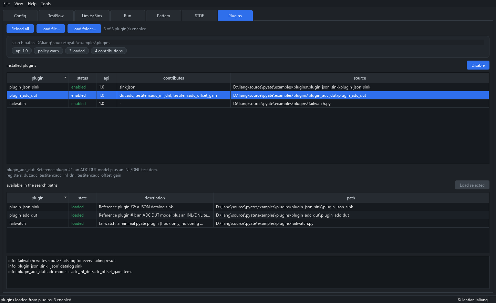

菜单 **Tools → Plugins...**（`Ctrl+Shift+P`）或最后一个页签。顶部是搜索路径和 `api / policy / loaded /
contributions` 芯片；`installed plugins` 表列出 plugin / status / api / contributes / source，选中一行，下面
灰字是说明与注册清单；**Disable / Enable** 立即生效（停用会连它注册的 DUT 模型、test item、sink 一起撤掉）；
`available in the search paths` 是磁盘上有但还没加载的，双击即加载；**Load file... / Load folder... /
Reload all** 手工加载与重扫；底部日志是 registry 的 note / warning / error。写法见下面的[插件](#插件不改源码扩展模拟器)一节。

### 浅色与深色

默认浅色，View 菜单切换。同样几页的浅色版本：

| | |
|---|---|
| 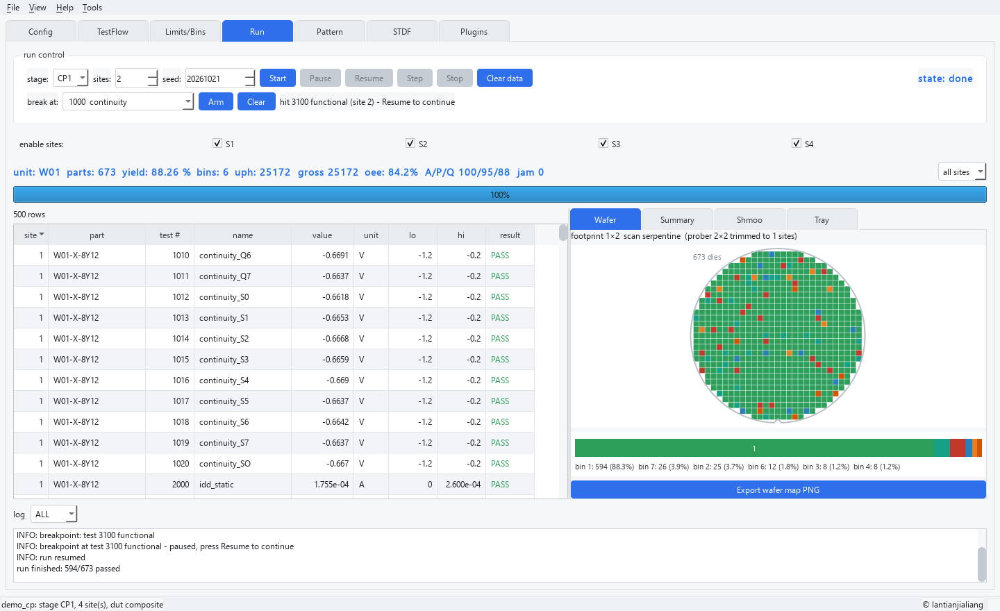 | 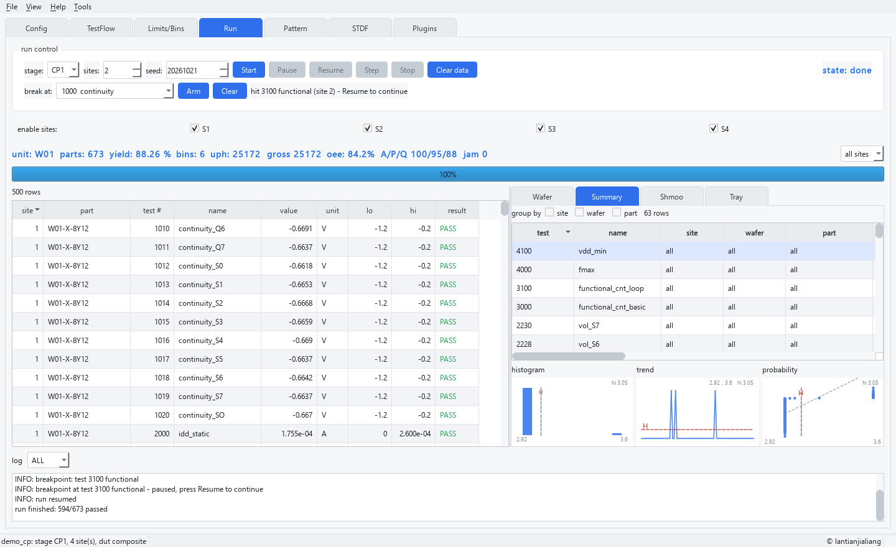 |
| Run（浅色） | Summary（浅色） |
| 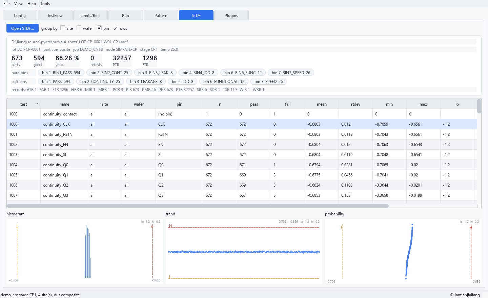 | 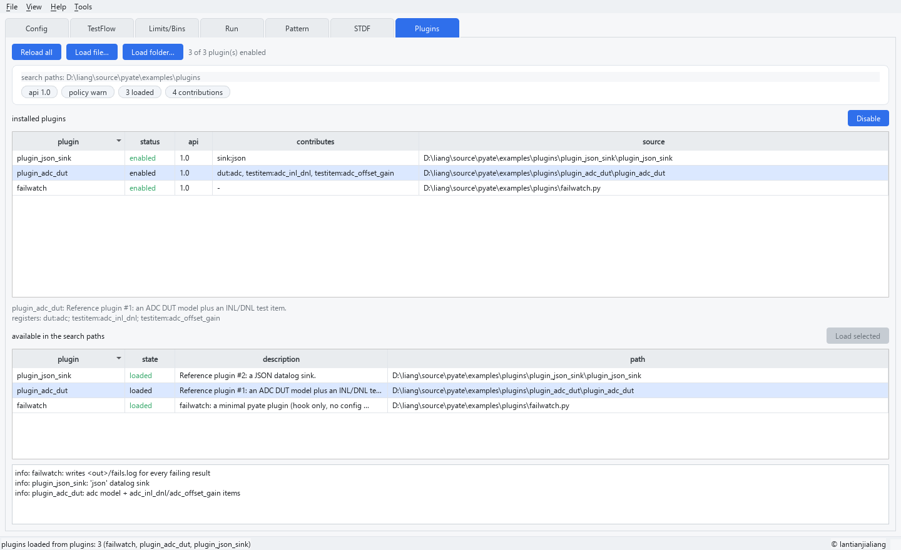 |
| STDF（浅色） | Plugins（浅色） |

重新生成全部截图（离屏渲染，不需要显示器）：

```bash
python tools/shoot_gui.py --run --sites 2 --paused 3100 --shmoo --plugins
python tools/shoot_gui.py --theme light --out docs/images/light --run --sites 2 --paused 3100 --shmoo --plugins
```

`--paused 3100` 在 3100 上下断点，截下暂停状态再继续跑完；`--shmoo` 换到 `demo_shmoo` 截一张真 shmoo；
`--plugins` 先加载 `examples/plugins` 再截 Plugins 页。

## 插件：不改源码扩展模拟器

插件是普通 Python 包（或单个 `.py` 文件），通过 [pluggy](https://pluggy.readthedocs.io/)
钩子接入。加载顺序：

1. **entry points**：包在 `pyproject.toml` 里声明 `[project.entry-points."pyate.plugins"]`，
   `pip install -e .` 后自动加载；
2. **目录扫描**：环境变量 `PYATE_PLUGIN_PATH` 指向一个目录（多个用 `;` 分隔），
   目录下的 `*.py` 和包目录都会被导入，不用安装；
3. **代码加载**：`pyate.plugins.load_plugins([...])` / `PluginManager().load_file(...)`。

`pyate plugin list` 打印当前加载了什么、注册了什么：

```
api 1.0   policy warn
PYATE_PLUGIN_PATH=examples/plugins
loaded: failwatch
note: failwatch: writes <out>/fails.log for every failing result
```

### 附带的示例插件

`examples/plugins/` 下有 3 个可以直接用的示例：

| 文件 / 目录 | 类型 | 作用 |
|---|---|---|
| `plugin_adc_dut/` | 包 | 注册 DUT 模型 `adc`（8 位 SAR ADC，引脚 `CLK/START/RDY/D0..D7`）和测试项 `adc_inl_dnl`（码密度直方图算 INL/DNL）、`adc_offset_gain`（两点 offset/gain）。`dut_profile.yaml` 写 `model: adc` 就能用 |
| `plugin_json_sink/` | 包 | 注册 datalog sink `json`：每颗 die 一行 JSONL（量测、bin、坐标全带上）写到 `<out>/<unit>.jsonl`；运行结束再写一个 `plugin_json_sink.json` 汇总 |
| `failwatch.py` | 单文件 | 只挂运行期钩子：把每条失败量测追加到 `<out>/fails.log`，不用改任何配置 |

两个包都是 `src` 布局（`plugin_adc_dut/plugin_adc_dut/__init__.py` + `pyproject.toml`），
既可以 `pip install -e` 走 entry point，也可以交给目录扫描直接加载（加载器会识别这种布局）。

### GUI 的 Plugins 页

菜单 **Tools → Plugins...**（或最后一个页签）打开插件管理页：

- 顶部一行是搜索路径：`PYATE_PLUGIN_PATH` 加上仓库（打包版是 exe 同级）的 `examples/plugins`；
- **installed plugins**：谁 enabled、API 版本、注册了什么（`dut:adc`、`testitem:adc_inl_dnl`、`sink:json`）、
  来自哪个文件。选中一行，下面的灰字是它的说明；右侧 **Disable / Enable** 立即生效（下一个 run 使用新的注册表），
  disable 会把插件注册的 DUT 模型 / test item / sink 一并撤掉，enable 再加回来；
- **available in the search paths**：磁盘上有但还没加载的插件，双击或 **Load selected** 直接加载；
- **Load file... / Load folder...**：加载任意 `.py` 或包目录；**Reload all** 重新扫描一遍；
- 底部日志列出 registry 的 note / warning / error（比如忘记 `@hookimpl`）。

GUI 与 CLI 共用同一个 `PluginManager`：`pyate plugin list` 看到的、GUI 里 Run 页跑的，是同一份注册表。

### 例子 1：只挂运行期钩子（不用改配置）

`examples/plugins/failwatch.py` 在每个测试项结束后把失败结果追加到
`<out>/fails.log`。核心就是这几个 hook：

```python
from pathlib import Path

from pyate.plugins.hookspec import API_VERSION, hookimpl

class Plugin:
    @hookimpl
    def pyate_api_version(self) -> str:
        return API_VERSION

    @hookimpl
    def before_lot(self, run=None, **kwargs):
        self.path = Path(run.output_dir) / "fails.log"

    @hookimpl
    def after_item(self, ctx=None, item=None, results=None, **kwargs):
        for result in results or []:
            if not result.passed:
                ...  # 写一行 test_num,test_name,site,part,value
```

跑一轮（PowerShell；cmd 用 `set PYATE_PLUGIN_PATH=examples\plugins`）：

```powershell
$env:PYATE_PLUGIN_PATH = "examples/plugins"
pyate plugin list
pyate run configs/demo_cp/session.yaml --out out/plugin_demo `
    --set run.sites=1 --set lot.wafers='["W01"]'
Get-Content out/plugin_demo/fails.log -TotalCount 5
```

运行结束会打印 `failwatch: 331 failing result(s) -> out\plugin_demo\fails.log`。
GUI 同理：先设环境变量再 `pyate gui configs/demo_cp/session.yaml`，日志里能看到插件输出。

### 例子 2：加一个自己的 TestItem

```bash
pyate plugin new my_plugin --dir plugins
```

把 `plugins/my_plugin/my_plugin/__init__.py` 改成：

```python
from pyate.plugins.hookspec import API_VERSION, hookimpl
from pyate.testitems.base import TestItem, TestItemParams

class VbgParams(TestItemParams):
    pin: str = "VDD"

class VbgItem(TestItem):
    name = "vbg"
    Params = VbgParams
    description = "bandgap reference voltage"

    def execute(self, ctx, hal):
        site = hal.site(ctx.site_id)
        site.pmu.connect(self.params.pin)
        volts = [site.pmu.measure_voltage(self.params.pin) for _ in range(4)]
        return [self.make_result(ctx, name="VBG", value=sum(volts) / len(volts), unit="V")]

class Plugin:
    @hookimpl
    def pyate_api_version(self) -> str:
        return API_VERSION

    @hookimpl
    def pyate_register(self, registry) -> None:
        registry.add_testitem("vbg", VbgItem)
        registry.note("my_plugin: vbg item")
```

安装并在配置里引用：

```bash
pip install -e plugins/my_plugin
pyate plugin list        # 应出现 testitems: vbg
```

```yaml
# testprogram.yaml 的 flow 里，和内置测试项一样用
- item: vbg
  test_num: 4100
  params: {pin: VDD}
```

`make_result()` 只返回原始量测，pass/fail 仍由 `limits.csv`（优先）或测试项默认限值判定。
DUT 模型、datalog sink、scenario 的写法与 hook 全表见 [docs/EXTENDING.md](docs/EXTENDING.md)。

## 目录结构

```
src/pyate/
├── api/         # 对外门面：Session/RunOptions/RunHandle/LotRunner（GUI 与 CLI 都只用这层）
├── config/      # pydantic 模型 + YAML 加载器 + 校验器
├── hal/         # 虚拟仪器（dps/pmu/relay/digital/timing）与资源管理
├── dut/         # DUT 行为模型、缺陷注入、良率采样
├── pattern/     # .pat 解析、向量模型、生成器、执行引擎
├── testitems/   # 内置 TestItem 库与注册表
├── engine/      # Flow 执行、binning、多 site 调度、事件总线、控制器
├── scenario/    # CP/FT 场景：wafer map、prober、handler
├── batch/       # 批量 spec/queue/runner/report/retest
├── datalog/     # CSV/Text/JSONL sink、stats、STDF writer/reader_check
├── plugins/     # pluggy hookspec、加载器、脚手架
├── gui/         # PySide6 面板 + 无 Qt 依赖的 view model
└── cli/         # argparse 命令行

tools/           # gen_demo_configs（生成示例配置）、coverage_std（trace 覆盖率）、
                 # export_wafer_map（binmap → PNG）
examples/        # 参考插件（ADC DUT / JSONL sink / failwatch 钩子）与参考运行产物
```

分层是单向的：`gui → api → engine → testitems → hal/dut/pattern → config/datalog`。
`core` 不 import `gui`（`tests/unit/test_layering.py` 会检查）。

## 测试

```bash
pytest                        # 全部（约 2 分钟，含离屏 GUI）
pytest tests/unit -q          # 单元
pytest tests/component -q     # HAL / testitem / flow
pytest tests/integration -q   # E2E-CP/FT/FLOW/BATCH/EXT/REPRO
pytest tests/concurrency -q   # 多 site / barrier
pytest tests/gui -q           # E2E-GUI（QT_QPA_PLATFORM=offscreen）
```

覆盖规格 14 的七个端到端场景：

| 场景 | 用例 |
|---|---|
| E2E-CP | `tests/integration/test_e2e_cp.py` |
| E2E-FT | `tests/integration/test_e2e_ft.py` |
| E2E-FLOW | `tests/integration/test_e2e_flow.py` |
| E2E-BATCH | `tests/integration/test_e2e_batch.py` |
| E2E-EXT | `tests/integration/test_e2e_ext.py` |
| E2E-REPRO | `tests/integration/test_reproducibility.py` |
| E2E-GUI | `tests/gui/test_gui_smoke.py` |

## 质量门槛

| 门槛 | 命令 | 现状 |
|---|---|---|
| 全部测试 | `pytest` | 435 例通过 |
| 行覆盖率 ≥85%（`src/pyate`） | `python tools/coverage_std.py --fail-under 85` | 见下 |
| 分层约束 | `pytest tests/unit/test_layering.py` | core 不含 Qt/gui，gui 只用 `pyate.api` |
| 示例配置可校验 | `pyate config validate configs/demo_cp/session.yaml`（demo_ft 同） | OK |
| lint / 类型 | `ruff check src tests tools` / `mypy` | 配置已就绪；**当前环境离线装不上这两个包**，见 D19 |

`tools/coverage_std.py` 用 `sys.settrace` 自建行计数器统计覆盖率（离线环境装不了
`pytest-cov`），支持 `--save-counts/--counts` 缓存计数，重复分析不必重跑整套测试；
`--json` 输出可直接喂给 CI。

## 参考产物

`examples/out/` 下有三份可直接查看的运行结果（配置与种子都写在各自的 `run_snapshot.yaml`）：

- `cp/` — CP1，673 die，yield 92.42%，含 `LOT-CP-0001_W01_CP1.stdf`、binmap（csv/svg/txt）与 `W01_map.png`
- `ft/` — FT1，40 part，yield 90.0%（含 contact fail 与重测）
- `lot/` — CP1 → CP2 → FT1 的 KGD 流转，`lot_report.md` 里是分阶段良率表

## 文档

| 文档 | 内容 |
|---|---|
| [docs/MANUAL.md](docs/MANUAL.md) | 使用说明书：工作原理、GUI 操作、demo_intro 走读 |
| [docs/QUICKSTART.md](docs/QUICKSTART.md) | 30 分钟上手：从校验配置到读懂产物 |
| [docs/CONFIG_REFERENCE.md](docs/CONFIG_REFERENCE.md) | 全部 YAML 字段、默认值、枚举与踩坑点 |
| [docs/EXTENDING.md](docs/EXTENDING.md) | 写 TestItem / DUT 模型 / Datalog sink 插件 |
| [docs/STDF_MAPPING.md](docs/STDF_MAPPING.md) | 配置与测试项如何落到 STDF 记录字段 |
| [docs/DECISIONS.md](docs/DECISIONS.md) | 规格歧义处的取舍与理由 |
| [docs/PROGRESS.md](docs/PROGRESS.md) | 逐阶段实现与验收记录 |

## 已知边界

- `parallel_mode: process` 退化为线程池（DUT 模型不可 pickle），日志会给出告警。
- 温度只影响 limit 查找与 STDF 记录，DUT 模型本身不随温度参数化（见 D15）。
- `run.only/run.skip` 不会自动补齐前序测试建立的物理条件（见 D16）。
- resume 以 touchdown 为粒度，不做 die 级续跑（见 D17）。
