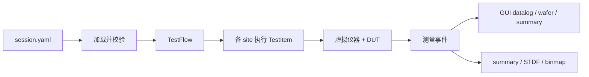

# PyATE 使用说明书

这份说明面向第一次打开程序的人。它讲三件事：模拟器在做什么、一次测试是怎么跑完的、界面和命令行上具体怎么操作。字段级的默认值和枚举在 [CONFIG_REFERENCE.md](CONFIG_REFERENCE.md)。30 分钟的命令行练习在 [QUICKSTART.md](QUICKSTART.md)。

## 1. 它模拟什么

PyATE 是一台离线的 ATE（自动测试设备）。没有真实仪器，也没有真实芯片。

一次运行里，程序按 `session.yaml` 把这些东西装到一起：

- **测试机**：虚拟的 DPS、PMU、继电器和数字通道。电压、电流、pattern 比较都发生在这里。
- **DUT**：数字行为模型（计数器、移位寄存器等）。缺陷和工艺波动按 `seed` 注入，所以同一个 seed 会得到同一批结果。
- **测试程序**：一棵 TestFlow。每个节点是一个 TestItem（漏电、静态电流、functional、shmoo、延时……），带 test number、参数和失败后的动作。
- **场景**：CP 用 prober 在晶圆上逐个 touchdown；FT 用 handler 在 tray 里逐颗上料。可以有多个 site 并行。
- **结果**：每条测量变成 datalog，每颗 die/part 得到 soft bin，最后写出 summary、binmap 和 STDF。

GUI 和命令行都只调用 `pyate.api`。界面上改配置、点 Start，和命令行 `pyate run` 走的是同一条执行路径。



## 2. 一次运行里发生的事

1. 读 `session.yaml`，再按里面的路径读 tester、channel map、levels、timing、limits、binning、DUT、wafer 或 handler、测试程序。
2. 校验通道是否冲突、pattern 引脚是否存在、test number 是否唯一。失败时指出**文件和字段**，并且不会用坏配置覆盖磁盘。
3. 按 lot 里的 wafer（CP）或 tray（FT）生成待测单元。`run.sites` 决定这次用几个 site。`run.disabled_sites` 里的 site 直接 mask 掉。`run.parallel_mode` 取 `sequential`、`thread`、`process` 或 `async`。`process` 实际退化为线程。
4. 每个 touchdown 上，执行器按 flow 顺序跑 TestItem。某个节点 `enabled: false` 会被跳过。`on_fail.action` 可以是 `continue`（记失败 bin，继续后面的项）、`stop`（这颗不再往下测）或 `retest`。
5. 每个 TestItem 之前都会看一次暂停。界面上的 Pause、断点和 Step 都作用在这里。
6. 测完一颗就发一条 part 结果（坐标或 part id、soft bin、第一个失败项）。CP 把 bin 画到 wafer 上，FT 画到 tray 上。
7. 全部结束后写 `summary.json`、`run_snapshot.yaml`（这次真正生效的配置）和 STDF。

虚拟时间由仪器自己推进（`simulation.sim_time_scale: 0` 时不等真实墙钟），所以一小片 wafer 通常几秒到几十秒就结束。`demo_cp` 是 300 mm、六百多颗 die，用来看完整良率；下面的 `demo_intro` 只有大约二十颗，用来学操作。

## 3. 配置文件各管什么

都从 `session.yaml` 指出去。路径相对于 session 文件所在目录。

| 文件 | 作用 |
|---|---|
| `tester.yaml` | 通道数量、向量深度、仿真噪声和虚拟时间比例 |
| `channel_map.yaml` | 引脚在每个 site 上占用哪条通道 |
| `loadboard.yaml` | 负载板编号、site 数、继电器名。pin 到通道只写在 `channel_map` |
| `levels.yaml` | 电平集：VIL/VIH/VOL/VOH 和 VDD |
| `timing.yaml` | 时序集：周期和驱动/比较沿 |
| `testprogram.yaml` | 各 stage 的 flow：item、test number、参数、`on_fail`、是否启用 |
| `limits.csv` | 每个 test 的上下限。比较时按 test number 和名字查找 |
| `binning.yaml` | soft/hard bin、pass bin、失败码到 bin 的映射 |
| `dut_profile.yaml` | DUT 模型、良率、缺陷比例、工艺 σ |
| `wafer.yaml` | 直径、die 尺寸、notch 方向、边缘排除、跳过的 die |
| `lot.yaml` | lot id、要测哪些 wafer、阶段顺序 |
| `prober.yaml` / `handler.yaml` | 换片时间、接触不良概率、site 排布 |
| `patterns/*.pat` | 数字向量。functional 和 shmoo 按名字来找 |
| session 里的 `run` | 这次用的 stage、site 数、seed、输出目录、禁用的 site |

在 Config 页改完点 **Save file**。程序先按模型校验，通过才写回。YAML 按模型重写，原来文件里的注释不会保留。

## 4. 安装和启动

需要 Python 3.10+。GUI 还需要 PySide6。

PowerShell，在仓库根目录：

```powershell
python -m venv .venv
.\.venv\Scripts\Activate.ps1
pip install -e ".[dev]"
```

已经安装过时：

```powershell
pyate gui configs\demo_intro\session.yaml
```

还没安装、直接从源码启动：

```powershell
$env:PYTHONPATH = "src"
python -m pyate.cli.main gui configs\demo_intro\session.yaml
```

默认是浅色主题。`--theme dark` 切到深色，`--theme light` 是显式指定浅色。不写 session 会打开空窗口，再到 Config 页 **Open...** 选择 `session.yaml`，然后 **Load**。

命令行跑同一份示例（不打开窗口）：

```powershell
$env:PYTHONPATH = "src"
python -m pyate.cli.main run configs\demo_intro\session.yaml
```

## 5. 用 demo_intro 走一遍

`configs/demo_intro` 是最短的一套可运行配置。它复用 `demo_cp` 的测试机、通道、电平和 bin 定义，自己只改了四件事：大约 20 颗 die 的小晶圆、1 个 site、一条四步 flow、两个 pattern。

Flow 顺序：

| test number | 项 | 用来看什么 |
|---|---|---|
| 2000 | `idd_static` | 有数值，Summary 里能出直方图、趋势和概率图 |
| 3000 | `functional` | 跑 `patterns/cnt_basic.pat`，这是会通过的向量 |
| 9000 | `delay_ms` | 专门用来下断点，停在这一项前面 |
| 9100 | `shmoo` | 3×3 的 VDD × period 扫描，跑完右侧 Shmoo 页有图 |

另外有一个故意写错的 `patterns/cnt_fail.pat`，不在 flow 里。Config 页的 `patterns` 下面能看到它和会通过的 `cnt_basic.pat`，失败原因写在文件开头的注释里。Pattern 页可以单步调试这份失败向量。

### 5.1 打开并确认配置

启动后状态栏应类似 `demo_intro: stage CP1, 1 site(s)`。

- **Config**：左边树是 session 引用的每个文件，以及 `patterns` 下的向量。`cnt_basic.pat` 是会通过的向量，`cnt_fail.pat` 是故意失败的向量；点失败的那一项，说明页写了原因：复位后第一拍 `SO` 仍是 0，文件里却写成了 `H`。点 `levels` 或 `run`，右边是表单和 YAML。改一个数字后 **Save file**；校验失败时下面的文本会带字段路径，磁盘上的文件不变。向量文件只读，不会被 Save 写成 YAML。
- **TestFlow**：应看到 `idd_static`、`functional`、`delay_ms`、`shmoo`。取消勾选会把 `enabled` 写成 false 并保存 `testprogram.yaml`，执行时跳过该项。选中一项可以改参数和 `on_fail`，再点 **Apply to node**。
- **Limits/Bins**：改 lo/hi 后 **Apply changes**，再在 Config 页 **Save limits** 才写回 CSV。

### 5.2 断点和单步

执行器在**每个测试项开始之前**看暂停。断点记的是 test number，所有 site 共用。

1. 打开 **Run**。
2. 断点框输入 `9000`，点 **Set**。标签变成 `breakpoints: 9000`。
3. 点 **Start**。上一轮的 datalog、wafer、summary 和 shmoo 会先清掉。flow 跑完 2000 和 3000 后，在 9000 之前停下。日志里有一行 `breakpoint hit: test 9000 ...`。
4. 点 **Step**：只执行接下来的一项（9000），然后再次暂停。再 Step 一次会跑 shmoo。
5. 点 **Resume** 会放开暂停，一直跑到结束。**Pause** 是在下一项之前停住。**Stop** 放弃这一轮。**Clear data** 丢掉当前结果并停掉正在跑的那一轮；断点和 site 勾选不动。
6. **Clear** 去掉全部断点。

想看“跑一项停一下”，也可以不设断点：Start 之后马上 Pause，然后反复 Step。

取消某个 site 的勾选（`S1`、`S2`……）再 Start，这些 site 不会测。这写入已有的 `run.disabled_sites`。`demo_intro` 只有 1 个 site。

### 5.3 看 wafer、summary 和 shmoo

Start 跑完后（大约几十秒，视机器而定）：

- **Wafer**：每颗 die 的颜色是 soft bin，边缘的 die 也是完整的方块，不会被圆边裁成一块。鼠标停在 die 上可以看到坐标、bin，以及这颗的第一个失败测试和值。圆片底部只有一个很小的定位豁口。下面一条是 bin 比例。**Export wafer map PNG** 把当前图存成图片。
- **Summary**：默认 **group by = test**，每个测试一行。改成 **site** 按 site 拆开，改成 **wafer** 按晶圆拆开（多片 wafer 时用 `demo_cp` 的 lot）。有数值的测试会列出 mean、stdev、min、max，以及规格 lo/hi、Cp、Cpk（Cp 要上下限都有，Cpk 有一边即可；σ 用样本标准差 n−1）。点一行，下面同时画该组的 histogram、trend 和 probability。三张图上的橙色虚线是 lower limit，红色虚线是 high limit；鼠标停在柱、点或限值线上会显示对应的值。probability 的横轴是测量值，纵轴是标准正态分位；灰色虚线是这组数据的正态参考线。
- **Shmoo**：flow 里的 9100 跑完后这里出现 3×3 的 pass/fail 色块。横轴是 period（ns），纵轴是 VDD。悬停一个格子可以看到电平和周期。**PNG** / **CSV** 导出。

不想把 shmoo 放进每一颗 die 时，从 flow 里取消勾选 9100，改用 Shmoo 页的 **Run shmoo**。它只用当前 session 的 DUT、电平和 pattern，在一个 site 上扫一次，不走整片晶圆。`demo_cp` 的默认 flow 就没有 shmoo，应该用这个按钮。

### 5.4 调试一条 pattern

Pattern 页不跑 flow，只对一个 `.pat` 做向量比较。

1. 打开 **Pattern**。
2. **Open...** 选择 `configs\demo_intro\patterns\cnt_fail.pat`。DUT 保持 `composite`，VDD 3.3 V，period 20 ns 即可。
3. 点 **Run pattern**。结果应是 FAIL。文字区给出第一个失败周期、期望值和实际值。
4. 下面的比较条按 pin 画出 expected 和 actual，不一致的 pin 是红色。

把文件换成 `cnt_basic.pat` 再跑一次，应是 PASS，比较条清空。flow 里的 functional 用的就是这份会通过的 pattern。

改向量的方法：`L`/`H` 是比较低/高，`0`/`1` 是驱动。`cnt_fail.pat` 只把第二拍的 `SO=L` 改成了 `SO=H`，所以比较会在 SO 上失败。

## 6. 界面上的其他页

**Batch。** **Open...** 选择 `configs\demo_batch\batch.yaml`，**Load** 后 **Run batch**。每行是一组参数扫描。结束后 **Open output** 打开该任务的输出目录。

**STDF。** **Open STDF...** 选择一次运行写出的 `.stdf`。上方是文件统计：lot、job、颗数、良率、每片 wafer 的 good/parts、hard/soft bin、各记录条数。下面的表和三张图与 Run 的 Summary 相同，也可以按 test、site、wafer 分组，数据来自文件里的 PTR/FTR，不是当前这次 GUI 运行。

**日志。** Run 页最下面。级别可选 ALL、INFO、ERROR。断点命中、shmoo 开始和结束、运行结束都写在这里。

**主题。** 打开时是浅色。菜单 View 里可以切到深色。状态栏右侧和 Help → About 是版权信息 © lantianjialiang。页签顺序是 Config、TestFlow、Limits/Bins、Run、Pattern、STDF，Batch 在最后。

多 site 的完整 CP 用 `configs\demo_cp\session.yaml`（300 mm、4 site）。FT、tray、卡料和重测用 `configs\demo_ft\session.yaml`，Run 页的 **Tray** 每个 site 一格，颜色是最近一颗的 bin，jam 会标出来。

## 7. 命令行

和 GUI 同一套配置。

```powershell
pyate config validate configs\demo_intro\session.yaml
pyate run configs\demo_intro\session.yaml --sites 1 --seed 7
pyate run configs\demo_cp\session.yaml --set lot.wafers='["W01"]' --sites 2
pyate pattern run configs\demo_intro\patterns\cnt_fail.pat --dut composite --cycles 64
pyate stdf verify out\某个文件.stdf
pyate batch run configs\demo_batch\batch.yaml
pyate lot run configs\demo_cp\session.yaml --stages CP1 --stage-session FT1=configs\demo_ft\session.yaml
```

`--set 点号路径=YAML值` 覆盖一项配置，不改文件。`--json` 打印机器可读的 summary。`--seed` 固定缺陷和噪声：同配置同 seed，测量结果一致。

`pattern run` 就是 Pattern 页的命令行形式，用来在不打开 flow 的情况下看第一个失败周期。

## 8. 产物怎么读

默认写到 session 里 `run.output_dir`（示例是仓库下的 `out/`，GUI 里也可以在运行前改）。

| 文件 | 内容 |
|---|---|
| `summary.json` | 这轮的 tested、passed、yield、UPH、每个 wafer 或 tray 一行 |
| `run_snapshot.yaml` | 含覆盖项在内的完整生效配置，复现问题时先看它 |
| `*_binmap.csv` | 每颗 die 的 x、y、bin |
| `stats.json` | 每个测试的均值、σ、Cpk |
| `*.stdf` | STDF V4，可用 `pyate stdf verify` 检查 |

GUI 的 Summary 是**这一轮已经收到的测量**的在线统计，按测试（以及可选的 site 或 wafer）汇总 mean、stdev 和 Cpk。它和 `summary.json` 里的 lot 级良率不是同一张表：lot 级看有多少颗 pass，测试级看某一个 test number 的分布。`stats.json` 是同一套 Cp/Cpk 写到文件里的版本。

## 9. 三套示例怎么选

| 目录 | 什么时候用 |
|---|---|
| `configs/demo_intro` | 学 GUI：断点、pattern 调试、shmoo、summary。晶圆很小 |
| `configs/demo_cp` | 看一片真实规模的 CP、wafer map 和 STDF。flow 里没有 shmoo |
| `configs/demo_ft` | Handler、tray、contact fail 和重测 |
| `configs/demo_batch` | 温度等参数的批量扫描 |

更长的字段说明、插件写法和 STDF 字段对照见 `docs/` 里的其他文档。
